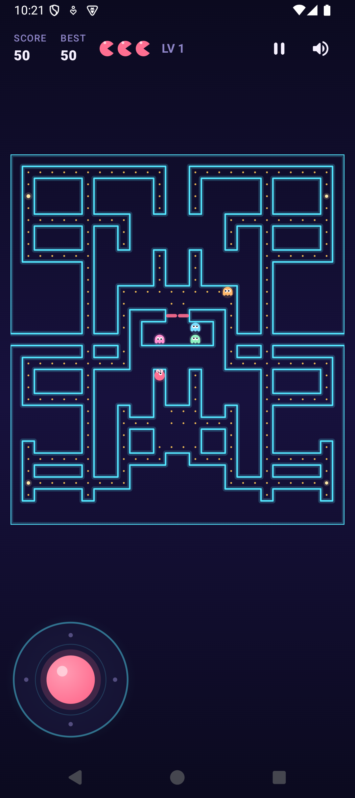

# Ms. Munch

An offline maze-chase game for kids. Guide Ms. Munch through glowing
mazes, munch every dot, and outsmart four candy-colored grumps. Short
rounds, immediate replay, and a saved best score. No internet, no ads,
and no runtime permissions.



## How to play

- Steer with the on-screen joystick. Drag anywhere in the control
  strip, or tap the edge of the base to pick a direction.
- Eat every dot and power pellet to clear the maze.
- Power pellets frighten the grumps for a few seconds. Catch them for
  bonus points that double with each grump in the same window.
- Fruit appears below the house after 70 and 170 dots and stays for a
  short time.
- Three lives per round, with one extra life at 10,000 points.
- Pause any time with the HUD button. Back pauses a live round; a
  second back exits. The game also pauses when the app goes to the
  background.
- Turn the phone either way. Portrait puts the joystick below the
  maze; landscape puts it in a side gutter.
- Pick a left or right joystick in the pause menu. The choice is
  remembered, along with mute and the best score.

## Build

Prerequisites: JDK 21, Android SDK, `adb`, and `just` on your `PATH`.

```bash
just build
```

Debug APK: `app/build/outputs/apk/debug/app-debug.apk`

## Install

```bash
just run
```

## Check and test

```bash
just check
just test
```

## Sounds

The eight bundled effects live in `app/src/main/res/raw` and are
generated with only the Python standard library. Regenerate them with:

```bash
just sounds
```

## Offline and private

- No internet permission and no network access.
- No ads, analytics, accounts, or tracking.
- All art and audio are bundled in the APK.
- Settings and the best score stay on the device.

## License

Licensed under either of

- MIT license ([LICENSE-MIT](LICENSE-MIT) or
  https://opensource.org/licenses/MIT)
- Apache License, Version 2.0 ([LICENSE-APACHE](LICENSE-APACHE) or
  https://www.apache.org/licenses/LICENSE-2.0)

at your option.
